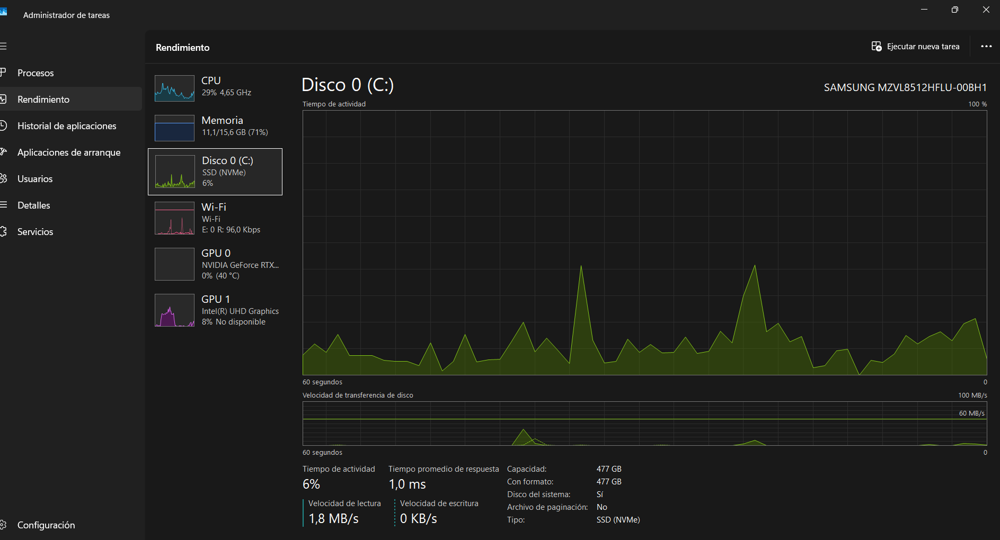

# Módulo 7 — Documento final tipo monografía

## 1. Objetivo

Conservar el documento final de presentación del proyecto integrador, organizar los materiales de apoyo disponibles y atender la recomendación docente de complementar con bibliografía y citas.

## 2. Descripción del contenido

El documento principal disponible es `Proyecto_Integrador_Agrometeorologico_Final.pdf`, de 466.044 bytes. Corresponde a la versión final identificada en la carpeta de origen. No se transformó su contenido ni se generó una versión nueva.

La transcripción de la retroalimentación docente indica que el último tramo de la explicación de este módulo se cortó en la grabación. Por ello no se establecen requisitos académicos adicionales como si hubieran sido indicados en clase.

## 3. Entregables organizados

No es posible enunciar una lista cerrada de requisitos académicos: la explicación del profesor quedó incompleta en la transcripción. Se organizan las categorías solicitadas en la estructura de referencia (documento principal, capítulos, introducción, resumen y palabras clave, referencias y anexos) sin afirmar que todas son obligatorias.

La recomendación expresa sobre bibliografía y citas se atendió en [`referencias/bibliografia_y_citas.md`](referencias/bibliografia_y_citas.md), con fuentes transcritas de los originales y un mapa de citas sugeridas.

## 4. Estructura de carpetas

```text
Modulo_7/
├── README.md
├── monografia/    Documento principal en PDF
├── referencias/   Bibliografía, citas sugeridas y documentos fuente
└── anexos/        Documento complementario de IA y cronograma
```

No se conservan carpetas vacías.

## 5. Relación de archivos existentes

| Archivo | Ubicación | Contenido verificado |
|---|---|---|
| `Proyecto_Integrador_Agrometeorologico_Final.pdf` | `monografia/` | Documento final del proyecto integrador. |
| `Ficha_Tecnica_Modelos_IA_y_Cronograma.xlsx` | `anexos/` | Ficha técnica de modelos de IA locales (RAG), banco de pruebas y cronograma Gantt de 16 semanas. Solicitado por el profesor como documento aparte en la retroalimentación. |
| `bibliografia_y_citas.md` | `referencias/` | 20 fuentes académicas y técnicas, 14 referencias normativas y 4 fuentes institucionales/propias, además de un mapa de citas sugeridas. Todo transcrito de archivos originales. |
| `Estado_del_Arte_Innovator_Terminado_2026.docx` | `referencias/` | Fuente de la sección 17 «Referencias»: estaciones IoT, humedad foliar, pluviometría y estación solar. |
| `01_ACTUALIZADO_Actividad_1_Estado_del_Arte_Sistema_Hidrometeorologico.docx` | `referencias/` | Fuente de la sección 11 «Referencias nuevas incorporadas»: pH, ISFET y Texas Instruments. |
| `02_Guia_Creacion_Sensor_Multiparametrico_Temperatura_pH.docx` | `referencias/` | Fuente de la sección «Referencias»: electrodos y sensores de suelo. |
| `Investigacion_Completa_Medicion_de_Lluvia_Innovator_2026.docx` | `referencias/` | Fuente de la sección 16 «Referencias»: WMO, IDEAM y pluviometría. |
| `Formulacion_del_problema_orientador_Diplomado_Energia_Circular_Inteligente_5_0.docx` | `referencias/` | Fuente de la sección 10 «Referencias normativas y bibliográficas». |

Los hashes SHA256 de los cinco DOCX fuente están registrados en `referencias/bibliografia_y_citas.md`.

## 6. Metodología

Se priorizó la versión `Final` del documento sobre las versiones intermedias encontradas en la carpeta de origen, sin eliminar esas versiones del equipo. El documento Excel se incorpora como anexo por petición docente, no como un entregable adicional de los módulos 5 y 6.

La bibliografía se construyó con las referencias que ya aparecían en los documentos originales del proyecto. No se consultaron fuentes externas para completar autores, años o enlaces, y no se modificó el PDF final.

## 7. Enlaces externos

No se registran enlaces externos nuevos en la documentación disponible. Los enlaces institucionales y DOI se conservan en `referencias/bibliografia_y_citas.md` tal como aparecen en los originales.

## 8. Evidencias

La retroalimentación que solicita la ficha de modelos de IA, el cronograma, la publicación en GitHub y la bibliografía se conserva en `../../Evidencias/Transcripcion_Retroalimentacion_Profe.md`.

La ficha de modelos pide datos de RAM y GPU/aceleradora. Como evidencia del entorno de trabajo se dispone de la captura del consumo de la PC durante el trabajo de OpenCode, conservada en [`Evidencias/capturas/consumo_pc_opencode.png`](../../Evidencias/capturas/consumo_pc_opencode.png):



La imagen se publica sin alterar; no se transcriben cifras que no sea posible verificar en este entorno.

## 9. Estado de avance

**Completo en lo verificable.** Existen el documento final en PDF, el anexo solicitado por el profesor y la bibliografía con citas sugeridas preparada a partir de los originales. La inserción física de las citas dentro del PDF y la revisión de su estructura interna quedan como revisión manual optativa, no como un entregable incumplido.

## 10. Cierre

No se registran acciones obligatorias adicionales con la información disponible. Si el profesor solicita las citas dentro del PDF, puede usarse el mapa de la sección 6 de `referencias/bibliografia_y_citas.md` como guía de edición.
