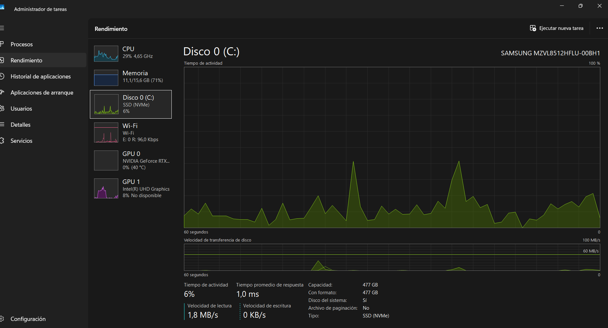

# Registro de enlaces y evidencias externas

## Repositorio

| Recurso | URL | Estado |
|---|---|---|
| Perfil de GitHub del estudiante | `https://github.com/jhosecuero-hue` | Verificado. |
| Repositorio GitHub `Diplomado-energia-circular` (nombre solicitado: `Diplomado energia circular`) | https://github.com/jhosecuero-hue/Diplomado-energia-circular | Público; creado para que los profesores puedan revisarlo. Rama `main` subida. GitHub convirtió los espacios del nombre solicitado en guiones. |

## Dashboard

| Recurso | Ubicación / URL | Estado |
|---|---|---|
| Dashboard meteorológico INNOVATOR (11 pestañas) | [Abrir dashboard desplegado](https://dashboard-meteorologico-ivory.vercel.app/) · `Entrega/Modulo_2/dashboard/index.html` | Disponible en línea y localmente; la versión local funciona sin conexión. |
| Servidor local sugerido | `http://localhost:8000` | Instrucción documentada en el README del dashboard. Requiere un servidor estático. |
| Despliegue en Vercel | [dashboard-meteorologico-ivory.vercel.app](https://dashboard-meteorologico-ivory.vercel.app/) | Verificado: responde y muestra el dashboard de 11 pestañas. Un clic redirige directamente a la plataforma. |

## Documentación de referencia

| Recurso | Ubicación | Estado |
|---|---|---|
| Transcripción de la retroalimentación del profesor | `Evidencias/Transcripcion_Retroalimentacion_Profe.md` | Disponible. |
| Captura de consumo de la PC durante el trabajo de OpenCode | [`Evidencias/capturas/consumo_pc_opencode.png`](capturas/consumo_pc_opencode.png) | Disponible. PNG de 1887x1020, 111.238 bytes, SHA256 `25A6065DD726C0ABA603BBE9710396D1DCC503AB4261430F0A0A377BB30579C0`. Aportada por el estudiante como evidencia de recursos; no se transcriben cifras no legibles en este entorno. |
| Enlaces a normas citadas (Ley 1715, Ley 2099, Decreto 2236, CONPES 4144, entre otras) | — | Citadas dentro de los documentos originales; no se incorporaron enlaces a fuentes externas porque no constan en los materiales revisados. |

## Evidencia de recursos computacionales

Imagen aportada por el estudiante, correspondiente al consumo de su PC durante el trabajo con OpenCode:

Esta imagen responde al espacio de captura del administrador de tareas previsto en la ficha técnica de los módulos 5 y 6 y sirve de soporte a la ficha de modelos de IA del módulo 7. Se publica tal cual; no se han estimado ni transcrito valores de CPU, RAM o GPU.

No se registran otros enlaces funcionales verificados.
