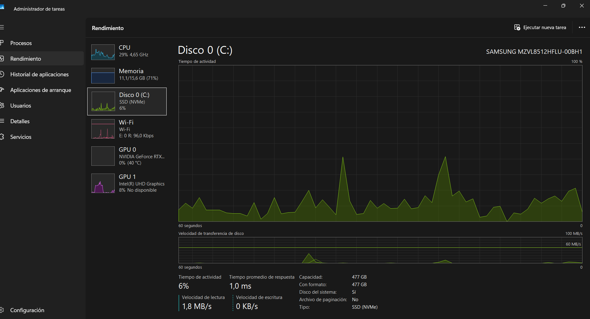

# Proyecto Integrador — Sistema Inteligente de Monitoreo Agrometeorológico (INNOVATOR)

Repositorio de documentación, análisis, desarrollo técnico y evidencias del proyecto integrador del Diplomado en Energía Circular Inteligente 5.0 (Unicomfacauca / SENA Tecnoparque Nodo Popayán / Empresa INNOVATOR).

> **Estado de publicación:** repositorio **público**, disponible en https://github.com/jhosecuero-hue/Diplomado-energia-circular (rama `main`). GitHub normalizó el nombre solicitado «Diplomado energia circular» al identificador `Diplomado-energia-circular` en la URL.

## Descripción

El proyecto aborda la gestión del riesgo climático en cultivos de Popayán (Cauca) mediante un prototipo electrónico de monitoreo agrometeorológico autónomo. Los documentos originales identifican como hallazgo central la descorrelación entre la humedad relativa del aire y la humedad foliar real, medida por la estación INNOVATOR entre junio y octubre de 2024 (2.999 registros horarios).

La documentación conserva los formatos originales de los entregables (DOCX, PDF, XLSX, IPYNB y HTML/JS) y no sustituye datos, cálculos ni conclusiones por ejemplos ficticios.

## Objetivo general

Texto consignado en el documento `Entrega/Modulo_1/documentos/Modulo1_Contexto_Territorial_Matriz_Normativa.docx`:

> Desarrollar un prototipo electrónico funcional para un sistema inteligente de monitoreo de variables hidrometeorológicas para la gestión del riesgo climático en sistemas agrícolas.

Nota: el documento `Formulacion_Problema_Proyecto_Integrador-v2.docx` registra una redacción ampliada que incluye variables edáficas (temperatura y pH del suelo). Ambas versiones se conservan; su vigencia requiere validación académica (ver `Documentacion_General/estado_avance.md`).

## Alcance

- Delimitación territorial: Popayán, Cauca; cultivos de café especial, frutales y hortalizas.
- Instrumentación: estación agrometeorológica de ocho equipos, comunicación LoRaWAN (915 MHz) y respaldo en tarjeta SD.
- Energía: sistema fotovoltaico off-grid con batería LiFePO4.
- Análisis: serie temporal real de INNOVATOR, EDA y modelos en notebook de Colab.
- Visualización: dashboard web estático de 11 pestañas construido sobre los datos reales y desplegado públicamente.
- Economía circular e indicadores: cinco KPI documentados en el entregable del módulo 4.
- Asistente local: arquitectura RAG offline documentada en la ficha técnica de los módulos 5 y 6.
- Bibliografía: fuentes transcritas de los originales y citas sugeridas en `Entrega/Modulo_7/referencias/`.

El alcance detallado está en [`Documentacion_General/alcance_proyecto.md`](Documentacion_General/alcance_proyecto.md). La comparación entre lo exigido y lo publicado se resume en [`Documentacion_General/evaluacion_entregables.md`](Documentacion_General/evaluacion_entregables.md). Las herramientas de IA declaradas se registran en [`Documentacion_General/herramientas_ia_utilizadas.md`](Documentacion_General/herramientas_ia_utilizadas.md).

## Organización del repositorio

```text
Diplomado-energia-circular/
├── README.md
├── .gitignore
├── Entrega/
│   ├── Modulo_1/       Diagnóstico y formulación del problema
│   ├── Modulo_2/       Dashboard y despliegue
│   ├── Modulo_3/       Predimensionamiento energético
│   ├── Modulo_4/       Economía circular e intervención
│   ├── Modulo_5_y_6/   Ficha técnica (entrega conjunta)
│   └── Modulo_7/       Documento final, bibliografía y anexos
├── Documentacion_General/
│   ├── alcance_proyecto.md
│   ├── inventario_entregables.md
│   ├── estado_avance.md
│   ├── evaluacion_entregables.md
│   ├── herramientas_ia_utilizadas.md
│   └── programa_diplomado.pdf
└── Evidencias/
    ├── capturas/
    ├── Transcripcion_Retroalimentacion_Profe.md
    └── enlaces.md
```

**Seis carpetas de entrega para siete módulos académicos.** Los módulos 5 y 6 se entregan conjuntamente en `Modulo_5_y_6/`; no existen carpetas `Modulo_5/` ni `Modulo_6/`. No se conservan carpetas vacías ni marcadores `.gitkeep`.

## Entregas

| Entrega | Descripción | Estado |
|---|---|---|
| Módulo 1 | Diagnóstico y formulación | Pendiente de verificación |
| Módulo 2 | Dashboard y despliegue | Completo |
| Módulo 3 | Predimensionamiento | Completo |
| Módulo 4 | Economía circular e intervención | Completo |
| Módulos 5 y 6 | Ficha técnica | Completo |
| Módulo 7 | Monografía, bibliografía y anexos | Completo |

Los criterios usados para asignar estos estados están en [`Documentacion_General/estado_avance.md`](Documentacion_General/estado_avance.md). La bibliografía y el mapa de citas están en [`Entrega/Modulo_7/referencias/bibliografia_y_citas.md`](Entrega/Modulo_7/referencias/bibliografia_y_citas.md).

## Enlaces a los módulos

- [Módulo 1 — Diagnóstico y formulación](Entrega/Modulo_1/README.md)
- [Módulo 2 — Dashboard y despliegue](Entrega/Modulo_2/README.md)
- [Módulo 3 — Predimensionamiento energético](Entrega/Modulo_3/README.md)
- [Módulo 4 — Economía circular e intervención](Entrega/Modulo_4/README.md)
- [Módulos 5 y 6 — Ficha técnica](Entrega/Modulo_5_y_6/README.md)
- [Módulo 7 — Monografía](Entrega/Modulo_7/README.md)

## Tecnologías y herramientas identificadas

Identificadas en los archivos originales y en la declaración del estudiante, sin ampliación:

- **Documentación:** DOCX, PDF, Markdown.
- **Datos:** XLSX (dataset INNOVATOR, laboratorio P4.1, ficha de modelos de IA y cronograma).
- **Análisis:** notebook de Google Colab (`web.ipynb`) con pandas, numpy, scikit-learn, TensorFlow/Keras, seaborn y Plotly.
- **Visualización:** HTML, CSS y JavaScript vanilla, con Plotly embebido; configuración de despliegue en Vercel (`vercel.json`) y acceso público en [dashboard-meteorologico-ivory.vercel.app](https://dashboard-meteorologico-ivory.vercel.app/).
- **IA local:** AnythingLLM Desktop y Ollama, modelos Llama-3-8B-Instruct / Mistral-7B cuantizados, embeddings `nomic-embed-text`, bases vectoriales LanceDB / ChromaDB (según la ficha técnica).
- **IA de apoyo declarada:** Google Gemini Notebook, ChatGPT, Perplexity, Claude y OpenCode; detalle en [`herramientas_ia_utilizadas.md`](Documentacion_General/herramientas_ia_utilizadas.md).
- **Control de versiones:** Git. Rama principal `main`.

## Instrucciones de navegación

1. Comience por el [inventario de entregables](Documentacion_General/inventario_entregables.md): indica qué archivo corresponde a cada módulo. Para un juicio global, consulte la [evaluación de entregables](Documentacion_General/evaluacion_entregables.md).
2. Abra el README de la carpeta `Entrega/` que desee revisar; cada uno enumera los archivos reales y el estado de la entrega.
3. Para abrir el dashboard desplegado, haga clic en [dashboard-meteorologico-ivory.vercel.app](https://dashboard-meteorologico-ivory.vercel.app/). Para examinarlo sin conexión, abra `Entrega/Modulo_2/dashboard/index.html` en un navegador, o sirva la carpeta con `python -m http.server 8000` (si Python está disponible) y visite `http://localhost:8000`.
4. El notebook `Entrega/Modulo_2/analisis/web.ipynb` espera el archivo Excel en la ruta de Colab indicada en su primera celda de carga; no se modificó su contenido.
5. Para revisar las fuentes y las citas sugeridas, abra `Entrega/Modulo_7/referencias/bibliografia_y_citas.md`.

## Evidencias

- `Evidencias/Transcripcion_Retroalimentacion_Profe.md`: transcripción de la retroalimentación docente que originó la ficha técnica, el cronograma, la publicación en GitHub y la recomendación de bibliografía.
- `Evidencias/capturas/consumo_pc_opencode.png`: captura aportada por el estudiante del consumo de su PC durante el trabajo de OpenCode. Responde al espacio de evidencia del administrador de tareas previsto en la ficha técnica de los módulos 5 y 6 y al soporte de recursos de la ficha de modelos de IA. No se transcriben cifras no verificables.



- `Evidencias/enlaces.md`: registro de enlaces, incluida la URL pública del dashboard desplegado en Vercel.

No se han incorporado credenciales, tokens ni claves API. Los estados reflejan la retroalimentación docente y las aclaraciones del estudiante del 17 de noviembre de 2026.
